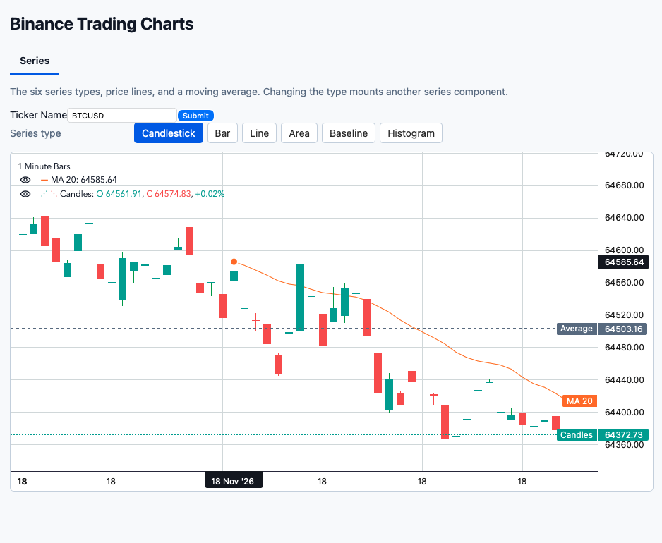

# crypto-analysis

A feed handler that ingests real-time cryptocurrency trades from Binance, stores them in TimescaleDB, and serves them through a GraphQL API to a Leptos (Rust/WASM) dashboard for charting and analysis.



## Overview

| Component | Technology | Role |
|---|---|---|
| Feed handler | Rust, Binance WebSocket | Ingest, parse, and normalize trades |
| Storage | TimescaleDB | Time-series storage and OHLCV aggregation |
| API | GraphQL | Query historical and live data |
| Frontend | Leptos (WASM) | Charts and analysis |
| Observability | Grafana (LGTM-stack)             | Distributed tracing + logging             |

## Architecture
```
Binance WS (@trade streams)
│  raw JSON
▼
Feed handler
parse → normalize → Trade{symbol, ts, price, qty, side, trade_id}
│
▼
bounded channel
│
▼
batch writer (todo: single writer)
│
▼
TimescaleDB
│  queries / aggregates
▼
GraphQL API
│
▼
Leptos dashboard
```

## Design Decisions

**Binance WebSocket as the data source.**

Free + public crypto trade data with `binance.us`, and requires no API key for market data streams. Binance allows for streaming trade data per cryptocurrency symbol as well as combining trade streams into one subscription.

**Direct writing instead of a message broker** 

Trade rates for a handful of pairs are well within what single/batched writes to TimescaleDB can absorb. Writing directly keeps the hot path short, latency lower, and is easier to implement in a short time.

**TimescaleDB for storage**

Using hypertables for time partitioning, compression, and continuous aggregates. Realtime aggregates are leveraged to create aggregations over pre-calculated data as well as most recent entries. This helps create time-bucketed bars out of tick data (OHLCV 1 min aggregation).

**GraphQL API**

Allows for dynamic client access to all trading data and OHLCV 1 min bars.


**Leptos frontend**

Fits into the Rust-first project and supports rich web charting. [trading_charts](https://github.com/corebreaker/rs-trading-charts/tree/main) for premade chart components.

## Getting Started

### Prerequisites for development

- Rust (stable 1.99.0) and `cargo`
- `wasm32-unknown-unknown` target and Leptos build tool (`trunk`)
- Docker

### Project Structure

```
crates
├── collector/      # WebSocket client, parsing, normalization
├── dashboard/      # Leptos dashboard for visualization
├── model/          # Common market data Rust types
├── framework/      # Common configurations, database, and observability
└── server/         # GraphQL schema and resolvers
```

### Running the Application

The entirety of the application is contained within the [compose.yaml](compose.yaml).

Running
```bash
docker compose up -d
```
will start the collector, TimescaleDB, server, and dashboard services.

[Cargo Chef](https://github.com/lukemathwalker/cargo-chef) was implemented to improve build performance over time with Docker and Rust dependency layer caching.

### Dashboard

Dashboard containerization is in progress. Until it is available, run the dashboard with the following:
```bash
cargo install --locked trunk
rustup target add wasm32-unknown-unknown
cd crates/dashboard
trunk serve
```
Open the dashboard at `http://localhost:9090`.

The GraphQL endpoint is accessible at `http://localhost:8080/api/graphql`.

Grafana is accessible at `http://localhost:3000` (see [future improvements](#limitations) )

Currently supported ticker values are the following:

`BTCUSD`, `ETHUSD`, `BNBUSD`, `XRPUSD`, `SOLUSD`, `TRXUSD`, `HYPEUSD`, `ZECUSD`, `DOGEUSD`, `XMRUSD`, `LINKUSD`, `ADAUSD`, `XLMUSD`, `NEARUSD`, `DAIUSD`, `LTCUSD`, `AVAXUSD`, `UNIUSD`, `CCUSD`, `SUIUSD`, `HBARUSD`, `SHIBUSD`, `TAOUSD`, `CROUSD`, `QNTUSD`, `PEPEUSD`

Note that data begins collecting when the application starts up and so the dashboard may take time to have a meaningful visual representation.

## Data Model

### Trades Schema

This TimescaleDB hypertable handles all ingestion of trade related events.
```sql
CREATE TABLE market_data.trades (
    trade_time TIMESTAMPTZ NOT NULL,
    symbol TEXT NOT NULL,
    trade_id INT8 NOT NULL,
    side market_data.trade_side NOT NULL,
    price NUMERIC NOT NULL,
    quantity NUMERIC NOT NULL,
    exchange TEXT NOT NULL,
    event_time TIMESTAMPTZ NOT NULL,
    insert_time TIMESTAMPTZ NOT NULL DEFAULT now()
) WITH (
    timescaledb.hypertable,
    timescaledb.partition_column = 'trade_time'
);
```

### Real-time Continuous Aggregates

Real-time aggregates allow for pre-computed historical aggregate buckets with on-the-fly aggregations of recent data from a source hypertable. This can be seen in the `market_data.candles_1m` materialized view.

## GraphQL API

Example Queries:
```graphql
query {
      candle1Minute(input: { symbol: "ETHUSD" }) {
        timeBucket
        symbol
        open
        high
        low
        close
        volume
    }
    trades(input: { symbol: "ETHUSD" }) {
        tradeTime
        symbol
        price
        quantity
        side
        exchange
        eventTime
    }
}
```

## Testing

```bash
cargo test --workspace
```

## Known Limitations and Future Work

<a name="limitations-anchor"></a>
### Limitations
- Single venue (Binance). The normalized `Trade` type allows adding other exchanges behind a common source interface.
- Ticks in flight at a crash can be lost. Add durability with a message broker (e.g. Kafka).
- Tick deduplication should be supported within TimescaleDB
- Observability has been limited with `logfire` rust implementation to send data to otel backend. Tracing and logging is currently done to stdout visible in each container. Switch to standard `opentelemetry` crates in the future.
- Trades are aggregated into 1 minute bars. This should potentially be extended to hourly and daily data.

### Future Work
- Benchmarking collector sink (TimescaleDB write) performance
- Adding more tests for failure scenarios, axum router tests, tests on dashboard methods (vwap, moving average), deduplication of tradeIds in database

## License

MIT
